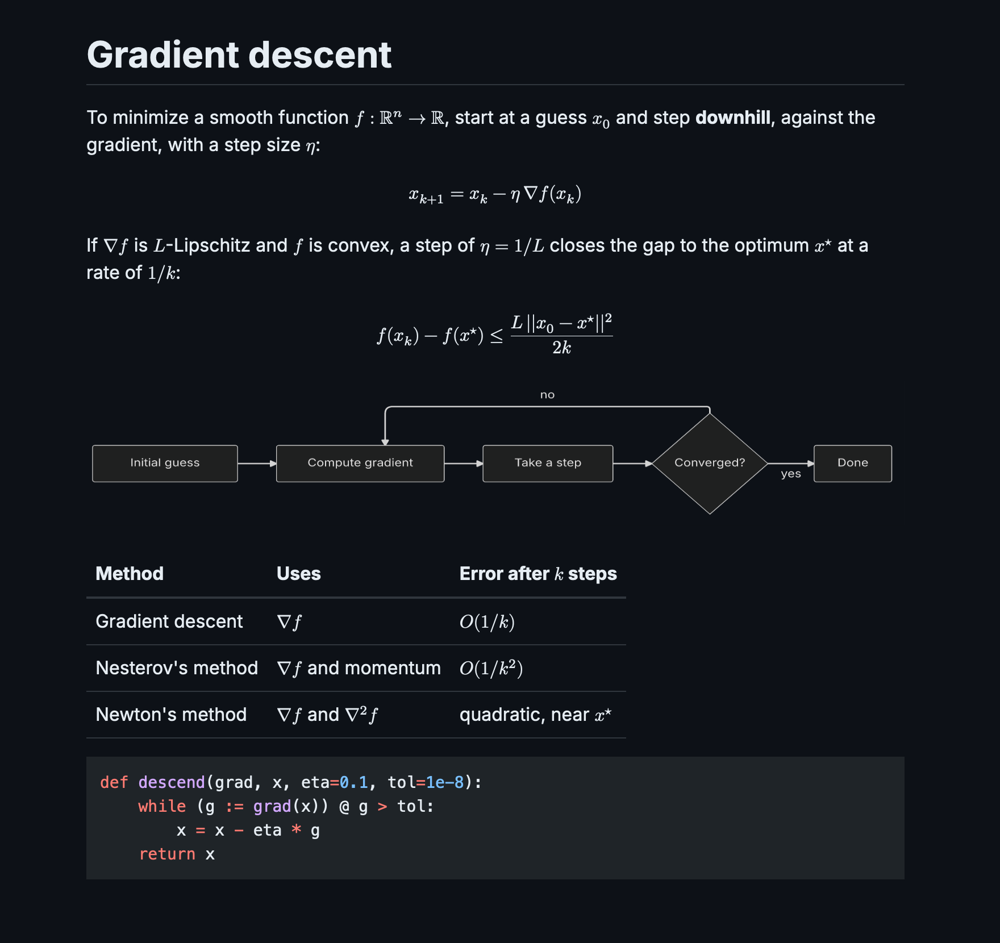

# md-tex

A fast, native Markdown reader and editor for macOS and Linux, with LaTeX math, diagrams and tables. It draws everything itself on the GPU, with no browser engine.



## Features

- A reading view, a source editor, and a split view with both side by side.
- LaTeX math, inline (`$...$`) and display (`$$...$$`), typeset with Typst.
- Mermaid, Pikchr and SVG diagrams.
- Tables that wrap their cells, task lists you can tick, footnotes and GitHub-style alerts.
- Code highlighting for Rust, Python, JavaScript, TypeScript, JSON, Bash, TOML, YAML, C and Go.
- Local images, and remote images when you allow them.
- Find and replace, a command palette, light and dark themes that follow the system, and zoom.

## Speed

md-tex opens straight to rendered text and stays responsive on large files. Equations, diagrams and images render in the background, so they don't hold up scrolling or typing.

| Measure | macOS (Apple M4) | Linux (Ryzen 7 7800X3D) |
|---|---|---|
| Launch to rendered text, 100 KB file | 173 ms | 280 ms |
| Launch to rendered text, 10 MB file | 203 ms | 335 ms |
| Keystroke handled and drawn, 1 MB file (median) | 1.3 ms | 0.3 ms |
| CPU per frame while scrolling a 10 MB file (99th percentile) | 3.1 ms | 3.1 ms |
| Each equation after the first (median) | 0.3 ms | 0.3 ms |
| Frames drawn while idle | 0 | 0 |

All the measurements, and how to reproduce them, are in [docs/benchmarks.md](docs/benchmarks.md).

## Install

Download the latest build from the [Releases page](https://github.com/runsonmypc/md-tex/releases). Checksums are in `SHA256SUMS`.

- **macOS 15 or later, Apple silicon:** unzip `md-tex-<version>-macos-arm64.zip` and move `md-tex.app` to Applications. The app is not notarized, so macOS blocks the first launch: try to open it once, then click **Open Anyway** in System Settings > Privacy & Security. Or run `xattr -dr com.apple.quarantine /Applications/md-tex.app`.
- **Linux, x86_64, X11:** extract `md-tex-<version>-x86_64.tar.gz` and run `./install.sh`, which installs into `~/.local` with a menu entry (`PREFIX=/usr/local sudo ./install.sh` installs system-wide). Or make `md-tex-<version>-x86_64.AppImage` executable and run it. Both need a Vulkan driver, which desktop distributions include. Wayland is not supported.

### Build from source

Install Rust with [rustup](https://rustup.rs); `rust-toolchain.toml` picks the version. On macOS you need the Xcode Command Line Tools (`xcode-select --install`). On Debian and Ubuntu:

```sh
sudo apt-get install clang libfontconfig-dev libfreetype-dev libwayland-dev libx11-xcb-dev \
  libxkbcommon-x11-dev libvulkan1 fonts-noto-cjk
```

Then, in a clone of this repository:

```sh
# macOS: installs ~/Applications/md-tex.app and an md-tex command in ~/.local/bin
tools/bundle-macos.sh --install

# Linux: installs into ~/.local with a menu entry
cargo build --release -p mdt-app --locked
assets/linux/install.sh target/release/md-tex

# Either: only the md-tex command
cargo install --path crates/mdt-app --locked
```

## Use

```sh
md-tex notes.md    # one window per file; an open file comes to the front
md-tex             # an empty window
```

| Shortcut (macOS / Linux) | Action |
|---|---|
| Cmd+E / Ctrl+E | Cycle between reader, source and split view |
| Cmd+P / Ctrl+P | Command palette: every command, the document's headings and recent files |
| Cmd+F / Ctrl+F | Find |
| Cmd+Alt+F / Ctrl+H | Replace |

All shortcuts: [docs/shortcuts.md](docs/shortcuts.md). Settings (theme, zoom, wrapping, a wider reading column and more): [docs/settings.md](docs/settings.md).

## Privacy

md-tex makes no network connections except to fetch remote images, and by default it does not fetch them: it shows a placeholder, and clicking it loads that one image. Set `remote_images = "allow"` to load them all.

## Feedback

Report bugs on the [issue tracker](https://github.com/runsonmypc/md-tex/issues). For security problems, see [SECURITY.md](SECURITY.md).

## License

Copyright (C) 2026 Alex. md-tex is free software under the [GNU General Public License, version 3](LICENSE), with no warranty. It includes fonts and code from other projects under their own licenses, listed in `THIRD-PARTY-LICENSES.md` in each release.
