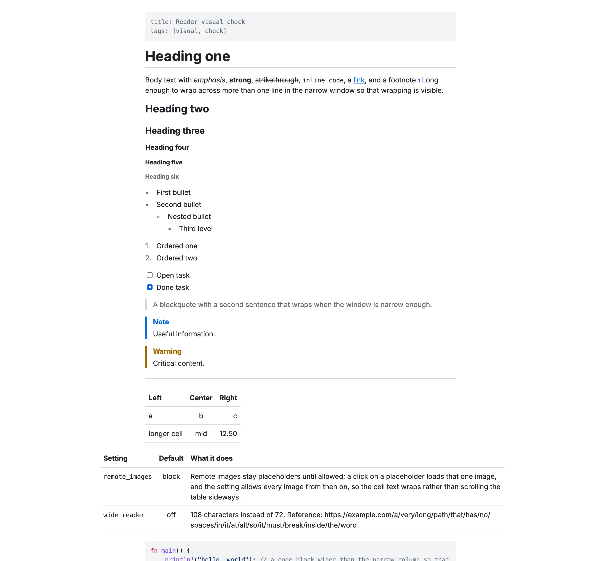

# md-tex

A native, GPU-rendered Markdown reader and editor for macOS and Linux, with LaTeX math and diagrams. It draws everything itself, with no browser engine.



md-tex opens Markdown files in a reading view. You can switch to a source editor or to a split view with both side by side. It renders:

- headings, lists, task lists (click a checkbox to toggle it), quotes, GitHub-style alerts, tables and footnotes
- code blocks highlighted for Rust, Python, JavaScript, TypeScript, JSON, Bash, TOML, YAML, C and Go
- LaTeX math, inline (`$...$`) and display (`$$...$$`)
- Mermaid, Pikchr and SVG diagrams
- local images, and remote images when you allow them (see [Privacy](#privacy))

Platforms: macOS 15 or later on Apple silicon, and Linux on x86_64 with X11. Wayland is not supported.

## Download

Prebuilt builds are on the [Releases page](https://github.com/runsonmypc/md-tex/releases).

- **macOS:** `md-tex-<version>-macos-arm64.zip`. Unzip it and move `md-tex.app` to Applications. The app is not notarized by Apple, so macOS blocks the first launch. To allow it, try to open it once, then open System Settings > Privacy & Security and click **Open Anyway**. Or run `xattr -dr com.apple.quarantine /Applications/md-tex.app` in Terminal.
- **Linux:** `md-tex-<version>-x86_64.tar.gz`. Extract it and run `./install.sh`, which installs md-tex into `~/.local` with a menu entry and icon (`PREFIX=/usr/local sudo ./install.sh` installs it system-wide). Or use `md-tex-<version>-x86_64.AppImage`: make it executable and run it. Both need a Vulkan driver, which desktop distributions include.

Each release lists SHA-256 checksums in `SHA256SUMS`.

## Build from source

Install Rust with [rustup](https://rustup.rs). The repository's `rust-toolchain.toml` selects the Rust version, and rustup installs it on first use.

- **macOS:** the Xcode Command Line Tools (`xcode-select --install`). Full Xcode is not needed.
- **Debian and Ubuntu:**

  ```sh
  sudo apt-get install clang libfontconfig-dev libfreetype-dev libwayland-dev libx11-xcb-dev \
    libxkbcommon-x11-dev libvulkan1
  ```

  Install `fonts-noto-cjk` as well to display Chinese, Japanese and Korean text.

Then:

```sh
git clone https://github.com/runsonmypc/md-tex.git
cd md-tex
```

macOS, as an app with its icon, menu bar and Finder "Open With":

```sh
tools/bundle-macos.sh --install
```

This installs `~/Applications/md-tex.app` and an `md-tex` command in `~/.local/bin`. Add that directory to your `PATH` if it is not there already.

Linux, with an application-menu entry and icon:

```sh
cargo build --release -p mdt-app --locked
assets/linux/install.sh target/release/md-tex
```

This installs into `~/.local`; set `PREFIX=/usr/local` to install system-wide.

Only the command, on either platform:

```sh
cargo install --path crates/mdt-app --locked
```

Release builds take several minutes. Run the same commands again to update.

## Use

```sh
md-tex README.md     # one window per file; a file that is already open comes to the front
md-tex               # an empty, untitled window
```

- Cmd+E (Ctrl+E on Linux) cycles between the reader, the source editor and the split view.
- Cmd+P (Ctrl+P) opens the command palette, with every command, the document's headings and recent files.
- Cmd+F (Ctrl+F) finds text, and Cmd+Alt+F (Ctrl+H) replaces it.

All shortcuts are in [docs/shortcuts.md](docs/shortcuts.md). Settings (theme, zoom, wrapping, the wide reading column and more) are in [docs/settings.md](docs/settings.md).

## Privacy

md-tex makes no network connections, except to fetch remote images in a document. By default it does not fetch them. It shows a placeholder instead, and clicking the placeholder loads that one image. Set `remote_images = "allow"` to load them all.

## Reporting problems

Report bugs on the [issue tracker](https://github.com/runsonmypc/md-tex/issues). For security problems, see [SECURITY.md](SECURITY.md).

## License

Copyright (C) 2026 Alex. md-tex is free software: you can redistribute it and change it under the terms of the [GNU General Public License, version 3](LICENSE). It comes with no warranty; see [LICENSE](LICENSE) for the full terms.

md-tex includes fonts and code from other projects under their own licenses. Each release ships them in `THIRD-PARTY-LICENSES.md`.
