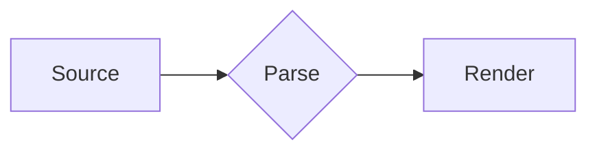

# Heading one

Body text with *emphasis*, **strong**, ~~strikethrough~~, `inline code`, a [link](https://example.com), and a footnote.[^1] Long enough to wrap across more than one line in the narrow window so that wrapping is visible.

## Heading two

### Heading three

#### Heading four

##### Heading five

###### Heading six

- First bullet
- Second bullet
  - Nested bullet
    - Third level
1. Ordered one
2. Ordered two

- [ ] Open task
- [x] Done task

> A blockquote with a second sentence that wraps when the window is narrow enough.

> [!NOTE]
> Useful information.

> [!WARNING]
> Critical content.

---

| Left | Center | Right |
|:-----|:------:|------:|
| a | b | c |
| longer cell | mid | 12.50 |

| Setting | Default | What it does |
|:--|:-:|:--|
| `remote_images` | block | Remote images stay placeholders until allowed; a click on a placeholder loads that one image, and the setting allows every image from then on, so the cell text wraps rather than scrolling the table sideways. |
| `wide_reader` | off | 108 characters instead of 72. Reference: https://example.com/a/very/long/path/that/has/no/spaces/in/it/at/all/so/it/must/break/inside/the/word |

```rust
fn main() {
    println!("hello, world"); // a code block wider than the narrow column so that it scrolls horizontally
}
```

Text with Japanese 日本語 and inline math $x^2$.

[^1]: The footnote text.

## Images and diagrams


An inline icon  sits on the text baseline.


```pikchr
box "Markdown" fit; arrow; box "Reader" fit
```



```svg
<svg xmlns="http://www.w3.org/2000/svg" width="60" height="60"><circle cx="30" cy="30" r="26" fill="#d33"/></svg>
```

```pikchr
box "A"; frobnicate
```

## Math $e^{i\pi} + 1 = 0$

The area is $\pi r^2$ units, and a tall formula $\displaystyle\sum_{i=1}^{n} \frac{a_i}{b_i}$ grows its line instead of overlapping the lines above and below it in this paragraph.

$$\int_0^1 x^2\,dx = \tfrac13$$

Text before $$\lim_{x \to 0} \frac{\sin x}{x} = 1$$ and text after.

```math
\begin{pmatrix} a & b \\ c & d \end{pmatrix} \begin{pmatrix} x \\ y \end{pmatrix} = \begin{pmatrix} ax + by \\ cx + dy \end{pmatrix}
```

Tall delimiters are built from glyph pieces:

$$
I_3 = \begin{bmatrix} 1 & 0 & 0 \\ 0 & 1 & 0 \\ 0 & 0 & 1 \end{bmatrix}, \qquad
|x| = \begin{cases} x & x > 0 \\ 0 & x = 0 \\ -x & x < 0 \end{cases}
$$

$$\newcommand{\R}{\mathbb{R}} f: \R^n \to \R, \quad f(x) = \sum_{i=1}^{n} \sum_{j=1}^{n} a_{ij} x_i x_j + \sum_{i=1}^{n} b_i x_i + c + \sum_{k=1}^{n} \frac{x_k^2}{1 + x_k^2} + \prod_{k=1}^{n} \left(1 + \frac{1}{x_k^2 + 1}\right) - \int_0^1 \frac{dt}{1 + t^2}$$

| Quantity | Formula |
|---|---|
| Energy | $E = mc^2$ |
| Ratio | $\frac{a}{b}$ |

Not math: $ y=x$ and $1$2$3, and costs \$5. Broken: $\foo{x}$.
