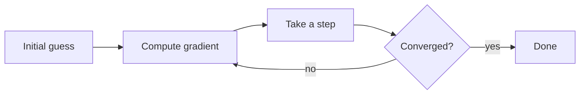

# Gradient descent

To minimize a smooth function $f : \mathbb{R}^n \to \mathbb{R}$, start at a guess $x_0$ and step **downhill**, against the gradient, with a step size $\eta$:

$$
x_{k+1} = x_k - \eta \, \nabla f(x_k)
$$

If $\nabla f$ is $L$-Lipschitz and $f$ is convex, a step of $\eta = 1/L$ closes the gap to the optimum $x^\star$ at a rate of $1/k$:

$$
f(x_k) - f(x^\star) \le \frac{L \, \lVert x_0 - x^\star \rVert^2}{2k}
$$



| Method | Uses | Error after $k$ steps |
|---|---|---|
| Gradient descent | $\nabla f$ | $O(1/k)$ |
| Nesterov's method | $\nabla f$ and momentum | $O(1/k^2)$ |
| Newton's method | $\nabla f$ and $\nabla^2 f$ | quadratic, near $x^\star$ |

```python
def descend(grad, x, eta=0.1, tol=1e-8):
    while (g := grad(x)) @ g > tol:
        x = x - eta * g
    return x
```
